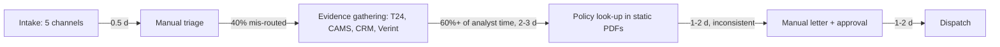
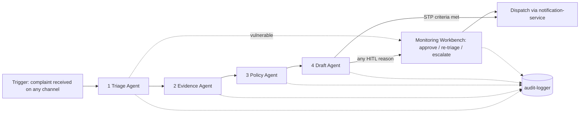

# Process Studio – As-Is → To-Be (Clearview Complaints)

## 1. As-Is process (timing, error rates, bottlenecks)

| Step | Avg time | Error / issue | Bottleneck |
|------|----------|---------------|-----------|
| Intake & logging | 0.5 d | channel re-keying | duplicate entry |
| Triage | 0.5-1 d | **40 % mis-routed** on first triage; vulnerable not consistently flagged | no shared taxonomy |
| Evidence | 2-3 d | 60 %+ of analyst time; 4 systems | manual swivel-chair |
| Policy | 1-2 d | static PDFs -> inconsistent redress | no queryable rules |
| Draft + approval | 1-2 d | rework, authority checks by hand | serial approvals |
| **Total** | **7-10 d** (FCA 8 w, SRC 3 d) | **£48 / case**, £12M fine exposure | |

## 2. Use-case prioritisation
| Use case | Volume | Value | Feasibility | Priority |
|----------|-------:|-------|-------------|----------|
| Duplicate charges / fees | 28 % | high STP | high | 1 |
| ATM & payment failures | 22 % | high STP | high | 2 |
| Unauthorised transactions | 18 % | high risk | medium (HITL) | 3 |
| Mortgage/loan | 15 % | medium | medium | 4 |
| Closure & switching | 10 % | medium | high | 5 |
| Data & privacy | 7 % | regulatory | medium (DPO) | 6 |

## 3. To-Be 4-agent workflow

**Trigger:** `POST /api/complaints` (or batch). **SLA:** P1 4 h, P2 24 h, P3 72 h; end-to-end agent time < 2 min.

**STP criteria (all must hold):** confidence >= 0.90 • redress <= £150 • outcome uphold / partial_uphold • not vulnerable • no legal threat • not DATA_PRIVACY • FCA deadline > 48 h • intent known.

## 4. Escalation rules
| Rule | Action |
|------|--------|
| Vulnerable customer (text marker, CRM flag, age >= 75) | **Hard stop**: P1, guardrail alert, mandatory human review |
| Redress > £150 | Mandatory HITL |
| Delegated authority | Analyst ≤ £50, Lead ≤ £250, Manager ≤ £1,000, above => Escalate to Investigations |
| Legal threat / FOS mention | HITL, P1 |
| FCA deadline < 48 h | P1, banner |
| DATA_PRIVACY | HITL + DPO route |
| Rejection of complaint | HITL approval |
| Any agent error / schema violation | `ERROR_HITL` (fail safe) |

## 5. Agent handshake payloads (abridged; full schemas in `specs/contracts/schemas/`)
```json
// Triage -> Evidence
{"complaint_id":"CMP-10001","intent":"ATM_PAYMENT_FAILURE","confidence":0.97,"priority":"P2","sla_hours":24,"vulnerable":false,"legal_threat":false,"route_team":"PAYMENTS","citations":["cv:Intent/ATM_PAYMENT_FAILURE","cv:Rule/ATM-POLICY"]}
// Evidence -> Policy
{"complaint_id":"CMP-10001","completeness":1.0,"refund_candidate":60.0,"findings":{"shortfalls":[{"debited":200,"dispensed":140,"shortfall":60}]},"citations":["cv:System/T24","cv:System/CAMS"]}
// Policy -> Draft
{"complaint_id":"CMP-10001","outcome":"uphold","refund_amount":60.0,"compensation_amount":25.0,"redress_total":85.0,"authority_required":"cv:Authority/LEAD","rules_cited":["cv:Rule/ATM-POLICY","cv:Rule/DISP-1.6"],"confidence":0.95}
// Draft -> Workbench / dispatch
{"complaint_id":"CMP-10001","letter_type":"SUMMARY_RESOLUTION","stp_eligible":true,"hitl_required":false,"hitl_reasons":[],"dispatch":{"action":"SEND","channel":"EMAIL"}}
```

## 6. Target impact
| KPI | As-Is | To-Be |
|-----|-------|-------|
| Agent processing | 5-8 working days manual | < 2 min + human review for ~65 % |
| Cost / case | £48 | ≈ £24 (2x saving) |
| Mis-routing | 40 % | < 10 % |
| Vulnerable identification | inconsistent | 100 % recall |
| DISP compliance | breaches | deadline banners + SLA tiers |
